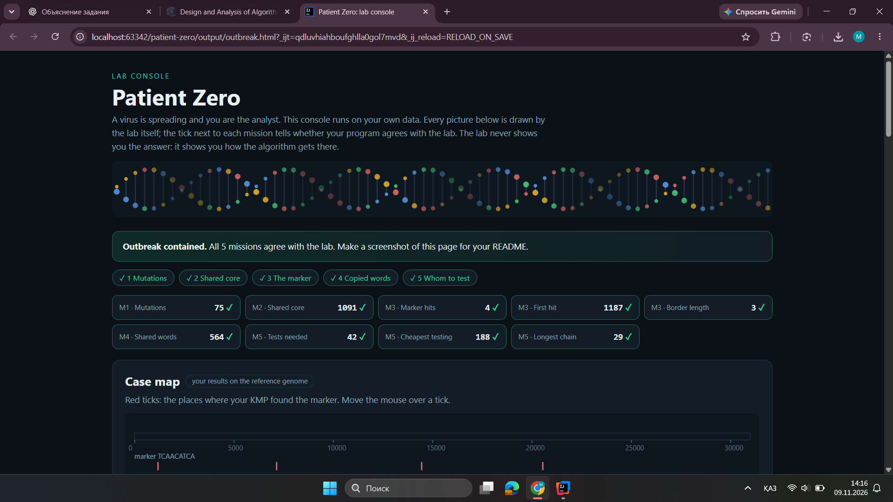

# Assignment 4. Patient Zero

Student ID: 253466
Name: Mekhrinsa Idrissova
Group: SE-2510

This file is the report. Fill it in as you go. How to start: `START_HERE.md`. The task: `docs/Assignment4.pdf`.

## Program output

The 9 lines your program prints on your data (`java -cp out Main`):

    Mutations: 75
    Shared core: 1091
    Marker hits: 4
    First hit: 1187
    Border length: 3
    Shared words: 564
    Tests needed: 42
    Cheapest testing: 188
    Longest chain: 29

My outbreak report (a screenshot of `output/outbreak.html`):

## Questions

Mission 1. The cell `d[i][j]` represents the minimum number of operations needed to transform the first `i` characters of one strain into the first `j` characters of another. It is calculated by choosing the minimum cost among insertion, deletion, and replacement.

Mission 2. The longest common subsequence keeps the same order of characters, but they do not have to be next to each other, while a substring must be continuous. My Shared core is bigger because LCS can match characters at different positions, not only at the same index.

Mission 3. The prefix function shows the length of the longest proper prefix that is also a suffix. In KMP, the text pointer never moves backward because the prefix function helps skip unnecessary comparisons. My Border length is 3, meaning the first three characters of my marker are also its last three characters.

Mission 4. We must compare the actual letters because two different strings can have the same hash value, which is called a collision. If many windows have the same hash, Rabin-Karp becomes slower because it needs more character comparisons.

Mission 5. Each person has two DP states: tested and not tested. If a person is not tested, all their children must be tested; if they are tested, we choose the cheaper state for each child. A greedy approach may fail because choosing the person with the most links does not always minimize the total testing cost.

## AI use

I used ChatGPT to understand the algorithms, including Dynamic Programming, LCS, KMP, Rabin-Karp, and Tree DP. I also used it to fix compilation errors, understand Git commands, and prepare to defense. I tested the implementations using the provided Check.java program and verified the results on my own data.

## Timing (Mission 7)

Milliseconds, average of 3 runs, from `java -cp out Bench`.

| Test | Size | Time (ms) |
|---|---|---|
| Naive search | 20 000 | 25.8 |
| Naive search | 40 000 | 63.7 |
| Naive search | 80 000 | 133.8 |
| KMP | 20 000 | 1.3 |
| KMP | 40 000 | 1.1 |
| KMP | 80 000 | 0.3 |
| Edit distance | 500 | 4.8 |
| Edit distance | 1000 | 6.8 |
| Edit distance | 2000 | 20.7 |
| Edit distance | 4000 | 71.6 |

The results show that naive search becomes approximately two times slower when the text size doubles, while KMP remains very fast. KMP times fluctuate because the measurements are very small and affected by runtime overhead. Edit distance grows much faster, approaching four times the execution time when the input length doubles, which agrees with its quadratic time complexity.

What do the numbers say about how the time grows? When you double the size, by how much does each time grow? Two or three sentences.

## Complexity

n is the length of the text (or of a strain), m the length of the pattern, k the length of the window, v the number of people. Fill in every algorithm you wrote.

| Algorithm | Time | Space | Assumptions |
|---|---|---|---|
| Edit distance | O(n × m) | O(n × m) | n and m are the lengths of two strains; full DP table |
| LCS | O(n × m) | O(n × m) | n and m are the lengths of two strains; full DP table |
| Prefix function and KMP | O(n + m) | O(m + h) | n is text length, m is marker length, h is the number of matches stored |
| Rabin-Karp (shared words) | O(n + m + C × k) expected | O(m) | Rolling hashes use constant-time updates; C is the number of candidate window comparisons; hash collisions are verified |
| Tree DP | O(v) | O(v) | The infection graph is a tree with v people and v − 1 edges |

## Before you submit

- The four files in `data` and the screenshot `output/outbreak.png` are in the repository.
- `java tools/Check.java` shows all examples right.
- This README is filled in, the program output and the section AI use included.
- The work is pushed to main (at least one commit per mission) and the repository is public.
- The link is attached in Moodle.
